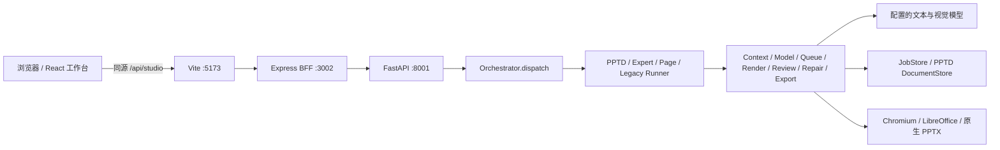

# PPT Studio 后端与 Agent

工作台使用同源 `/api/studio` 接口。浏览器不接触模型密钥，也不直接调用 Python 服务。



## 启动

日常使用推荐项目根目录的 `./start.sh`、`./status.sh`、`./stop.sh`，修改 `.env` 后运行 `./start.sh --restart`。脚本会隔离继承的模型凭证，并统一管理进程和日志，详见 [启动与停止](startup.md)。下方 `pnpm dev` 是手动开发方式，会继承终端环境变量；不要与启动脚本同时运行。

Node.js 22、pnpm 和 Python 3.11+ 为基础环境。所有 Python 依赖安装到项目根目录 `.venv/`，不要使用系统全局 pip。

```bash
pnpm install
uv venv .venv
uv pip install --python .venv/bin/python -r agent_service/requirements.txt
cp .env.example .env
# 按需编辑 .env 中的服务端模型配置后运行：
pnpm dev
```

可分别运行三个进程：

```bash
pnpm dev:agent
pnpm dev:backend
pnpm --filter frontend dev --port 5174
```

`dev:agent` 使用 `.venv/bin/python -m uvicorn agent_service.app:app --host 127.0.0.1 --port 8001`。Python 仅在本机监听。Express 默认监听 `0.0.0.0:3002`，Vite 监听 `0.0.0.0`。本次工作台使用 [http://192.168.0.10:5174/](http://192.168.0.10:5174/)；其他机器访问时替换为实际服务器局域网 IP。端口 5174 被占用时需先检查是否已有本项目开发服务。

端口 3000 已有其他服务，本项目 BFF 使用 3002。`PORT`、`HOST` 可覆盖 BFF 监听配置；`AGENT_SERVICE_URL` 可覆盖 Python 服务源地址，默认 `http://127.0.0.1:8001`，必须是没有路径、凭证或查询串的 HTTP(S) 源地址。修改 BFF 端口时同时修改 `frontend/vite.config.ts` 的代理目标。

## 模型配置

AgentScope 使用真实模型调用；缺少配置或调用失败时返回明确错误，不会伪造成功结果。密钥只保留在后端环境中。

| 环境变量                                     | 用途                                 |
| -------------------------------------------- | ------------------------------------ |
| `PPT_LLM_PROVIDER`                           | `anthropic` 或 `openai`              |
| `PPT_LLM_MODEL`                              | 当前服务实际支持的模型名称           |
| `ANTHROPIC_API_KEY` / `ANTHROPIC_AUTH_TOKEN` | Anthropic 兼容服务凭证，API Key 优先 |
| `ANTHROPIC_BASE_URL`                         | 可选 Anthropic 兼容服务地址          |
| `OPENAI_API_KEY`                             | OpenAI 兼容服务凭证                  |
| `OPENAI_BASE_URL`                            | 可选 OpenAI 兼容服务地址             |

未指定 provider 时，有 Anthropic 凭证优先选用 Anthropic，否则选 OpenAI。未设置 `PPT_LLM_MODEL` 时，Anthropic 依次使用 `ANTHROPIC_MODEL`、`ANTHROPIC_DEFAULT_SONNET_MODEL`，OpenAI 使用 `OPENAI_MODEL`。不在仓库内记录密钥；项目 `.env` 被忽略，`.env.example` 可提交。以服务实际环境和 `.env.example` 为配置依据。

Python 服务启动时自动读取项目根目录 `.env`，已有进程环境变量优先；改动配置后重启服务。AgentScope 固定为 2.0.9，使用 `Agent` 的 ReAct 流程及 `reply(..., structured_schema=...)`。策划、写作、编辑均使用真实大模型，无模拟回退。项目数据默认保存在 `runtime/studio`，可用 `STUDIO_DATA_DIR` 指定绝对目录。

真实预览和 PDF 使用 LibreOffice：优先使用 `LIBREOFFICE_BIN` 或 PATH 中的 `libreoffice`。本机已存在 `wechatopenai/weknora-docreader:latest` Docker 镜像，内含 LibreOffice 7.4 和中文字库，服务可自动回退到该镜像；其他主机需自行安装 LibreOffice，或准备含 `libreoffice` 可执行文件的镜像并设置 `PPT_RENDERER_IMAGE`。转换容器不联网、以当前用户运行，并限制资源及 Linux capabilities。渲染后用 PyMuPDF 从实际 PDF 生成 PNG，PPTX/PDF/预览内容保持同一来源。LibreOffice 与 Microsoft PowerPoint 对字体和复杂元素的显示可能存在差异。

## 职责与数据流

1. 工作台提交项目、主题、受众、页数及附件参考资料，创建 `outline` 任务。
2. 策划 Agent 先形成叙事结构；内容 Agent 根据结构生成标题、摘要、正文要点与讲稿。结构化输出通过 Pydantic 校验，页数不符时返回错误。
3. 用户确认大纲后提交 `render` 任务，选择内置主题或上传的公司模板，生成真正的 PPTX 文件和可用的预览产物。
4. 对话修改使用 `revise` 任务，可针对当前页或整份演示。页内编辑保留已有页面 ID，重新生成文件后才能让下载产物反映最新内容。
5. 项目、模板、任务状态和生成产物保留在服务器运行时目录；浏览器刷新后可重新读取。并发生成、取消与错误由 Python 任务层处理，BFF 不承担模型调度。

接口按 `/api/studio` 分组，核心资源为 `projects`、`templates`、`jobs` 和 `artifacts`。项目支持读取、列出和保存；模板上传使用 `multipart/form-data`；任务支持创建、查询状态、关键节点进度、取消、重试和恢复；产物接口返回文件。`/jobs/{id}/events` 使用 SSE 推送任务快照，断线后客户端可回退轮询。具体参数与返回字段以 `agent_service/models.py` 和 FastAPI OpenAPI 文档为准。Python 服务本机文档地址为 `http://127.0.0.1:8001/docs`。

任务状态只允许合法迁移：`queued → running → completed/failed/cancelled/interrupted`。`JobStore` 原子持久化任务，`JobRuntime` 统一进度、事件和检查点，`JobStream` 统一 SSE 快照、心跳和终止条件。四个 Runner 共享这些边界：

- `pptd_runner.py`：快速生成、编辑和导出。
- `expert_runner.py`：AgentScope 文件工具型 PPT 专家。
- `page_action_runner.py`：页面修复、视觉检视和设计。
- `legacy_runner.py`：未迁移旧项目的兼容路线。

Express 直接转发请求与响应流，不在上传前调用 `express.json()`，因此 multipart 边界和文件字节保持完整。代理层已兼容将来使用 SSE 时的及时刷新响应头、关闭代理缓冲及保留 `Last-Event-ID`；客户端断开会关闭对应上游连接。文件下载保留 MIME、状态码和 `Content-Disposition`。上游不可达返回可读的 502 错误；`GET /api/health` 仅表示 BFF 自身可用，不代表模型与 Python 已就绪。

## 模板生成边界

公司模板支持 `.pptx` 和 `.potx`，最大 30 MB、60 页。保留模板母版、主题、版式、配色、字体、背景和图片；按示例页顺序复制页面，超出示例数量后复用最后一页。生成内容填入标题和主要正文文本框，保留段落与字体样式；无正文框时新增并提示。上传包含可编辑文本框、标题及正文占位符的代表性演示，通常比只有截图的文件更适合继续编辑。

模板继承不等于自动理解任意复杂设计。整页图片中的文字、复杂 SmartArt、图表数据绑定及任意元素的自动重排不属于当前文本编辑的完整支持范围。图表、表格和额外装饰文字保留原内容；生成 PPTX 不保留原动画及切换效果。服务拒绝宏、OLE、外部链接资源和不安全的 ZIP/XML。生成结果应在预览与 PowerPoint 中检查；缺失字体可能由渲染环境替换。

当前是局域网工作台，服务器项目与模板由访问该实例的用户共享；尚未实现账号隔离、权限与多人编辑冲突处理。公开部署前需要增加相应服务能力。

## 公司模板导入（PPTD v2）

选择 PPTD v2 工作流时，上传的公司模板会先被解析成可编辑的 PPTD 文档，再作为生成参考。导入按 Office 标准对象实现，不做整页位图化：

| 对象                 | 处理方式                                                                                    |
| -------------------- | ------------------------------------------------------------------------------------------- |
| 组合（Group）        | 展平为元素，按组合变换换算到幻灯片坐标；组合旋转会记录提示                                  |
| 自由曲线（Freeform） | 转为 `shapeName: custom`，保留 viewBox 与 SVG 路径，导出写回原生 `a:custGeom`               |
| 预设形状             | 保留 `prstGeom` 名称与调整值；浏览器端渲染 rect / roundRect / ellipse / homePlate / chevron |
| 图片                 | 保留裁剪与宽高比；负裁剪（外扩）折叠进图片框，与 Office 实际渲染一致                        |
| 表格                 | 导入单元格填充与四条显式边框，导出写入原生 `a:lnL/lnR/lnT/lnB`                              |
| 图表                 | 柱形/条形/折线/面积/饼图/圆环；圆环保留孔径、起始角、逐扇区颜色与数值标签                   |
| 填充                 | 纯色与渐变（线性/径向）双向映射；图片填充仍不支持                                           |

上传校验只拒绝真正的外部资源引用：图表 `externalData` 留下的空目标关系（PowerPoint 常见）不再被当作外部链接。导出报告中的 `fontSubstitutions` 会列出被替换的字体，例如 Windows 专有字体映射到开源等价字体：`微软雅黑`、`等线`、`思源黑体` → `Noto Sans CJK SC`，`Arial` → `Liberation Sans`，`宋体` → `Noto Serif CJK SC`。替换是显式的，会随导出告警一并展示。

仍未导入的项会写入导入报告，不阻断流程，但会影响观感：母版/主题继承的隐式颜色与效果、对象阴影与透明度、文本框内部边距（PPTD 无对应字段）、字符间距/上下标、项目符号标记、动画与切换。验收方式：`pptd_engine/tests/test_template_import.py` 覆盖上述往返，`pptd_engine/tests/viewer.browser.test.cjs` 覆盖浏览器端矢量渲染。

## 验证

```bash
pnpm test:fast
pnpm test:contract
pnpm test:pptd
pnpm build
# 服务已启动且 LibreOffice 可用时：
.venv/bin/python -m unittest agent_service.test_service -v
```

BFF 集成测试使用临时端口上的真实 HTTP 服务，验证：

- multipart 原始字节、路径和查询串的完整转发；下载文件字节与文件名保留。
- SSE 首条消息在上游结束前到达；重连游标透传；浏览器取消后上游连接关闭。
- Python 校验错误的状态与信息透传；离线错误为 502，BFF 健康检查仍正常。
- 非 HTTP 源地址、带凭证或带路径的上游配置会被拒绝。

本次 Python 验证结果：5 项集成测试通过，覆盖项目读写、异常模板与大小/页数限制、任务取消与失败、实际 PPTX/PDF/PNG 生成、PPTX/POTX 公司模板。公司模板测试检查背景颜色、标题字体、图片二进制和主题 XML 保留。真实模型另外完成两页策划/写作及指定页修改，确认未选中的页面与页面 ID 保持不变。

浏览器端也完成真实四页“新员工信息安全培训”生成，并上传公司测试模板生成实际 4:3 PPTX/PDF/预览，验证播放效果。测试创建的 `acceptance-*` 项目及未被正常项目引用的合成模板已移至 `runtime/test-results/service-acceptance`，当前工作台使用的模板和产物继续保留。集成测试针对运行中的服务执行，会创建测试项目与模板；建议在独立 `STUDIO_DATA_DIR` 启动测试服务后运行，避免污染日常项目库。

## 工作记录持久化更新（2026-09-30）

新增 `DELETE /api/studio/projects/{id}` 和 `POST /api/studio/projects/{id}/restore`。删除将项目移入 `STUDIO_DATA_DIR/trash`，保留共享模板与生成文件以便撤销；已删除 ID 的延迟保存/生成请求返回 410，防止旧标签页复活记录。恢复后可继续保存和编辑。

每个任务保存 `projectId`，项目保存 `activeJobId`。任务完成时服务端写入页面、回复与生成版本，不依赖浏览器轮询才能保存结果。删除记录会取消其活动任务；服务重启会把中断任务对应的项目恢复为可编辑状态。同一记录生成期间拒绝另一任务或覆盖保存，返回 409。

项目额外保存页数、听众与参考材料；继续对话时编辑 Agent 会收到当前页面、参考材料和最近 20 条对话。原型与验收 Demo 已移出活动项目/模板库，不再在首页加载。

记录相关测试使用临时目录和模拟生成结果，不调用真实模型，也不污染项目库：

```bash
.venv/bin/python -m unittest agent_service.test_work_history -v
```
