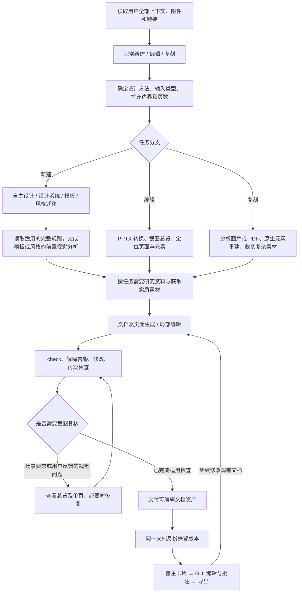

# Kimi PPT 完整迁移：原文基线与决策材料

日期：2026-10-09。状态：**已选定 A：以 PPTD v2 为主文档标准。高级渲染能力、AgentScope 生成、主应用编辑、版本和快照导出已接入；实际验收结果见主应用集成记录。**

用户已确认：**Kimi 配套引擎无法取得**。后续不再以取得官方CLI、编辑器或私有接口为前提；讨论按公开规范独立实现所需能力，具体技术方案未定。

文档模型决定：PPTD v2是页面内容与样式的权威定义，内部编辑对象和渲染缓存由其派生；不另立一套简化的主文档格式。详见[已确认的文档模型及下一步讨论](gap-and-decisions.md#d01-已确认采用a)。

最新进展：[主应用集成与实际验收](main-integration.md)、[集成计划](main-integration-plan.md)与[五项高级能力实现与验收](advanced-capabilities.md)。早期基线见[联合选型实测与推荐](engine-evaluation.md)，包含可运行实验、编辑后 PPTD/PPTX、呈现对比图及明确的能力缺口；[候选技术研究](engine-candidates.md)提供三条路线的一手资料依据。

## 本次目标

用户要求完整迁移 Kimi PPT skill 的生成流程和规则，并先列出它依赖的 Kimi App 封装，再决定如何实现。后续不能再把“提炼若干原则”称为完整迁移，不能用现有六类版式、固定字数预算或单次修订上限替代原文能力。

完整迁移分为四个独立验收面：

1. **规则完整**：原始主流程、通用规则、七类场景指南及字体规则全部保留，包括触发条件、禁止项、建议与例外。不能把场景示例变成每次必用的模板。
2. **行为完整**：新建、编辑、复刻、设计系统、公司模板、风格迁移、素材、校验、交付、多轮修改等分支均能执行。
3. **文档模型完整**：按已选定的 PPTD v2，完整覆盖它的字段、样式继承、资源路径、元素、图表、动画和校验语义，不能仅换一个文件后缀。
4. **宿主能力完整**：资产卡片、编辑器、导出、版本与资源保存等用户可见行为有对应实现。底层私有源码和未公开 API 不在现有材料中，不能宣称已掌握或复刻。

## 已保存的完整原文

- 原文目录：[original](original/SKILL.md)。共 **13 个文件、3,177 行**，逐字节复制，保留原始换行及全部示例。
- 来源：`/home/figodxp/workspace/skill_research/ppt/skills/kimi-slides/`。
- [manifest.json](manifest.json)：来源、各文件字节数、行数和 SHA-256，用于验证复制未删改。
- [原文章节索引](source-index.md) / [机器可读章节索引](sections.json)：224 个代码块之外的 Markdown 标题定位。
- 这份副本是需求与兼容性基线，**并非私有 Kimi 引擎**。`agent_service/kimi_rules.py` 将核心六份原文及选中场景的完整规则注入实际 AgentScope 调用，原始文件未修改；私有工具由末尾明确列出的本地实现映射承接。

| 原文 | 范围 | 行数 |
|---|---|---:|
| [SKILL.md](original/SKILL.md) | 主流程、输入分型、生成分支、校验、交付 | 120 |
| [slides_categories.md](original/reference/slides_categories.md) | 通用约束及七类场景选择 | 34 |
| [七类场景](original/reference/slides_categories/) | 场景叙事、布局、配色、字体、图表与检查规则 | 924 |
| [pptd.md](original/reference/pptd.md) | 完整文档格式、字段与渲染语义 | 1,644 |
| [cli.md](original/reference/cli.md) | 三个已公开命令与检查问题类型 | 111 |
| [fonts.md](original/reference/fonts.md) | 字体选择、名称、CDN 与 Google Fonts | 86 |
| [shapes.md](original/reference/shapes.md) | 内置形状目录、调整参数和默认值 | 258 |

## 阅读顺序

1. [流程与规则清单](workflow-rules.md)：原文要求什么、哪些条件触发哪些分支。
2. [App 与配套工具能力清单](app-capabilities.md)：Kimi 文档明示了哪些封装，哪些只是由行为推导出的实现需求，哪些仍未知。
3. [当前差距与待决策项](gap-and-decisions.md)：目前代码做到了什么、之前简化了什么、需要先作哪些选择、怎样验收。
4. [联合选型实测](engine-evaluation.md)及[候选技术研究](engine-candidates.md)：当前具体实验结果、限制和推荐组合。

上面的清单是可追溯索引，不能替代 `original/` 中的完整规范。特别是场景参考的全部段落、配色示例、图表字段与形状枚举，均以对应原文为完整定义。

## 完整目标流程

说明：模板、编辑与复刻的前置视觉分析，与校验阶段的条件截图复核分开。版本节点表达同一文档保留历史的行为，不表示已知Kimi内部提交时序。主 skill 要求多轮 `check`，但没有统一规定每轮都截图，也没有指定固定 Agent 数量、三阶段架构、固定迭代次数、每次必须确认大纲或统一页面模板数量。

## 证据边界

本次读取的是本地用户提供的 skill 与项目源码；没有访问 Kimi 私有接口，没有拿到转换器或编辑器源码，没有运行 Kimi CLI。原文中对能力的描述是待复现的公开契约，不能当作已验证的黑盒测试结果。用户已确认配套引擎不可取得并选定PPTD v2路线A，其余技术选型留在决策清单中。
