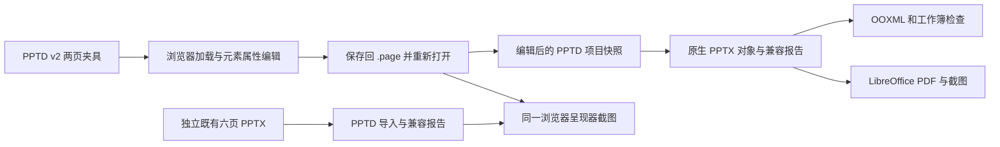

# PPTD v2 首轮联合选型验证

> 本文保留首轮选型的历史结论。公式、图标、动画、13类图表和字体嵌入的后续实现已覆盖下文相应旧缺口，请以[高级能力实现与验收](advanced-capabilities.md)为当前状态。

日期：2026-10-09。结论：**建议采用共享 PPTD 文档核心、自建浏览器编辑呈现、独立 PPTX 适配层的组合。基础子集已经贯通；完整兼容尚未实现。**

用户已确认的决定仍是 D01（PPTD v2 唯一权威）和 D02（Kimi 引擎不可得）。本报告提供 D03/D04 的具体评估结果与推荐，**没有将推荐自动登记为用户的最终技术选择**。实验代码为一次性验证，未接入生产服务、Agent 工作流或当前生成入口。

## 1. 已经实际执行的链路

不是只分别调用了两个转换工具：浏览器实际将第一页标题文字、X 坐标（64→88）和第二页标题文字保存回 `.page`；导出程序随后读取这份编辑结果的逐字节快照。PPTX 文本和坐标断言、PDF 文本检查都核对了修改后的值。

| 验证 | 实际证据 | 结论边界 |
|---|---|---|
| 文档权威与精确保存 | 9 组不变量检查：重开恢复、未改文件字节一致、同页公式/图标/动画保留、非法编辑拒绝等 | 保存的是 PPTD；JSON 仅用于传输、报告及独立 App 元数据。编辑页的 YAML 排版/注释会规范化。 |
| 浏览器操作 | Chromium 152.0.7977.64 + Playwright 1.62.1；7 组端到端检查通过 | 可选择元素、改文本源及数值坐标、保存、重新加载；不是成品富文本编辑器，未做拖拽、输入法、撤销或协同验收。 |
| 编辑后 PPTX | python-pptx 1.0.2；214 项结构/内容断言 | 证明指定夹具的文本、坐标、原生对象和数据；这些断言数量不等于规范功能覆盖率。 |
| 导出呈现 | LibreOfficeDev 26.8.0.0.alpha0，生成两页 PDF/PNG，并查看两页对比图 | 没有在 Microsoft PowerPoint 中实际编辑或播放；开发版 LibreOffice 也不是已选择的生产转换版本。 |
| 独立既有文件导入 | 本项目此前的 6 页样例，63 文本框、29 条线、1 图片；文字、换行边界、坐标及图片字节核验 | 93 对象全部映射，但继承与软换行存在有损解释；该样例没有复杂母版、组合对象和图表，不能代表任意第三方 PPTX。 |
| 导入后浏览器呈现 | 同一个呈现器加载全部 6 页、检查元素数量并截图；已查看总览 | 证明导入产物可呈现；未完成逐页像素保真验收。 |

完整执行记录：[evaluation.json](../../runtime/pptd-v2-spike/evaluation.json)。独立证据：[文档检查](../../runtime/pptd-v2-spike/document-report.json)、[浏览器检查](../../runtime/pptd-v2-spike/browser/browser-report.json)、[PPTX 检查](../../runtime/pptd-v2-spike/pptx-edited/verification.json)、[导入预览检查](../../runtime/pptd-v2-spike/import-browser/render-report.json)。

## 2. 七类元素及关键能力的实测结果

夹具共两页、14 个元素，覆盖全部七类元素类型。这只是用于暴露缺口的代表性输入，不是全规范验收集。

| 能力 | 浏览器呈现 / 保存 | PPTX 导出 | 判断 |
|---|---|---|---|
| 中文富文本、主题引用、自由坐标 | 样例中的粗体、斜体、主题色与坐标呈现；保存保留原主题引用 | 8 个原生文本框，包含富文本 runs；主题解析成直接格式 | 子集可用；完整继承、双字体、竖排与复杂断行待验收。 |
| shape / line | 矩形与两点直线呈现 | 1 个原生形状、1 条原生线 | 不能据此推导 177 个形状、全部 adjustments 与路径都支持。 |
| image | 校准图片左右各裁掉 12.5%，然后 `fit.fill` | 原生图片，OOXML `srcRect` 左右均为 12500 | 正向裁剪样例通过；负裁剪、cropShape 等未验证。 |
| table | 3×2 比例表格，主题行样式 | 原生表格；内容、列宽、行高和垂直对齐已检查 | 单元格边框没有完整映射，报告明确列出 6 个单元格差异。 |
| chart | SVG 基础柱状图，数据为合成的 Q1/Q2/Q3=12/18/15 | 原生柱状图与嵌入 XLSX，两处数据均核验 | 浏览器纵轴自动范围 0–18，Office 为 0–20；数据一致不代表布局一致。13 类图表尚未覆盖。 |
| icon | 显示明确的未支持占位，保存保留 `iconName` | 跳过该元素并给出定位报告 | 未实现；不能将 13 个原生导出对象解释成 14 个元素全部支持。 |
| LaTeX | 保存保留原始公式；当前显示公式源码并提示 | 普通文本框中的字面公式 | 未实现公式排版和 Office 原生公式。此文本框计入 13 个原生对象，不等于公式可编辑。 |
| 动画 | `fade-in` 字段在同页编辑后保留，不播放 | 未生成动画时间树，报告明确说明 | 仅验证数据不丢；22 效果及触发/时序/参数均未实现。 |
| 自定义字体 | JetBrains Mono 从规范允许的 Google Fonts URL 加载成功 | 写入字体名，未加载/嵌入字体文件；PDF 字体清单显示本机回退字体 | 字体声明保存成功不等于跨环境字体一致。 |

导出结果为 **13 个原生对象 + 1 个明确未支持的 icon**，未使用整页截图代替可编辑对象。导出共有 12 条有定位的兼容记录；不是“只有 12 项尚未兼容”的完整清单。[导出报告](../../runtime/pptd-v2-spike/pptx-edited/export-report.json)记录详细边界与 OOXML 证据。

对比图刻意保留尚未解决的差异：文本行距/基线、表格边框、字体、图表轴范围、公式与图标。默认阴影和表格垂直对齐问题则已在本轮修复并重新渲染。

导入结果：[6 页浏览器总览](../../runtime/pptd-v2-spike/import-browser/contact-sheet.png)及[导入报告](../../runtime/pptd-v2-spike/pptx-edited/imported/import-report.json)。导入报告包括全局母版/主题继承限制，以及 9 个文本框的 Office 软换行转段落近似，不能称为无损导入。

## 3. 这次验证揭示的工程约束

**必须有真正的 YAML 1.2 文档核心。** 默认 PyYAML 会把 `on` 当布尔值、`012` 当八进制 10、`1e3` 当字符串。浏览器实验补了部分 core 标量规则，但没有成为完整的 YAML 1.2 实现，PPTX 实验读取器仍明确限制为夹具子集。另测已安装的 `yaml@2.9.0`：这些标量、重复键拒绝、三份 PPTD 文件语义往返及样例注释保留均通过。因此建议正式核心采用 TS 的 YAML 1.2 AST 读写，随后再建立完整 PPTD schema 与语义校验。[解析器证据](../../runtime/pptd-v2-spike/yaml-candidate-report.json)

**精确编辑必须解决节点共享。** 独立审查复现了 YAML alias 让两个元素共享 `content`：修改一个元素会连带改另一个。实验版已明确拒绝 alias，并有回归检查；这是一项实验限制，不是对 PPTD 原规范增加禁令。正式核心应明确 alias 的解引用/编辑策略，验证局部编辑的影响范围。

**现有库的 API 返回成功不等于正确呈现。** 第一轮表格内容未按 `middle` 垂直对齐，已使用单元格属性修复。默认 Office 形状/线条阴影更说明问题：`shadow.inherit=False` 写入空 `effectLst` 后，LibreOffice 仍读取 `p:style/a:effectRef`。追加 `effectRef idx=0` 后，重渲染才确认阴影消失。该最小 OOXML 补丁已写入兼容报告；它证明需要有测试的格式适配层，不能只包一层库调用就宣称完成引擎。

**预览、截图与 PPTX 需要分别验收。** 网页编辑预览和网页截图可以共享一套实现；Office 自己负责 PPTX 排版，仍需跨引擎回归。浏览器加载了字体，并不会自动让 LibreOffice 或收件人的 PowerPoint 获得同一字体。

## 4. 对 D03 / D04 的推荐

三条路线的一手资料、固定版本/提交、许可证与部署证据见[候选技术研究](engine-candidates.md)。只有下面所述自建路线的基础探针实际运行过；PPTist、ONLYOFFICE、Collabora 均未部署，PptxGenJS 也仅完成源码/文档核查。

| 模块 | 推荐方向 | 依据与待补部分 |
|---|---|---|
| 文档核心 | 共享 TypeScript 核心，YAML 1.2 AST 读写；PPTD 保持唯一权威 | `yaml@2.9.0` 已完成限定语法探针；完整 schema、样式继承、资源解析、检查器和歧义处理仍要实现。 |
| 编辑器 | 在现有 React 前端自建 PPTD 元素编辑层 | 避免将 PPTist 或 Office 自己的主模型变成第二份真相；可借鉴已有编辑器交互，但原型目前只有属性面板。 |
| 呈现与截图 | 共用 DOM/SVG 页面呈现；字体和资源就绪后用浏览器截图 | 本轮已跑通；公式、全部形状、复杂表格/图表、动画和文字测量逐项补齐。富文本/公式/图表组件库仍需专项验证。 |
| PPTX 基础适配 | 复用 python-pptx 的已验证对象能力，增加独立 OOXML 适配及兼容报告 | 可利用现有 Python 服务；不能直接作为完整引擎。PptxGenJS 是否用于特定出口需后续实测，尚未决定增加第二套导出库。 |
| 导入与验证 | 原始 PPTX 作为参考证据保存，导入时解析并报告损失；LibreOffice 作为辅助呈现工具 | 原稿不能替代 PPTD 主文档；还需要第三方复杂 PPTX 样本、母版/组/占位符继承及 PowerPoint 验收。 |
| App 数据 | 批注、版本、任务等独立存储，编辑命令只改 PPTD 对应节点 | 本轮仅验证独立编辑记录；没有实现正式版本、卡片、批注或撤销系统。 |

现成开源编辑器能节省交互工作，但 PPTist 源码已显示公式图片化、bubble→scatter、图表及动画字段差集；要维持 PPTD 权威仍需深度适配。Office 套件的保存接口以 Office 文件为中心，也没有直接解决 PPTD 的受控回写。基于已确认的 D01，自建共享核心的组合更容易明确控制语义。

这是**推荐组合，不是已经交付的完整引擎**。D05–D10 中的模型/工具、资产卡片、导出入口、版本、修复预算及实施顺序仍按原决策清单讨论，未由本次技术探针代替决策。

## 5. 下一阶段的具体准入目标

推荐先交付文档核心，再逐项扩充呈现与 PPTX 适配；以下为实施范围建议，尚未作为生产实施计划执行：

1. 对完整 PPTD 字段、七元素、13 图表、22 动画建立 schema 与支持矩阵；明确已登记规范歧义的处理方式。
2. 统一所有入口的 YAML 1.2 解析、资源路径、节点身份和编辑保存，解决 alias、样式继承、引用与有损操作报告。
3. 将本次样例升级为正式回归集，加入双字体、负裁剪、合并表格、混合/复杂图表、公式、动画和第三方模板；每项分别检查源文档语义、网页呈现和 Office 对象。
4. 在这些约束上建设拖拽、缩放、富文本编辑、撤销、检查修复、资产交付及完整 Agent 工作流，保留此前归档的所有规则分支。

## 6. 可复现交付物

- [一次性实验代码与运行说明](../../experiments/pptd-v2/README.md)
- [经过浏览器编辑后的 PPTD 项目包](../../runtime/pptd-v2-spike/edited-pptd-project.zip)
- [编辑结果导出的 PPTX](../../runtime/pptd-v2-spike/pptx-edited/export.pptx) / [PDF](../../runtime/pptd-v2-spike/pptx-edited/export.pdf)
- [浏览器属性编辑界面截图](../../runtime/pptd-v2-spike/browser/editor.png)
- [全部机器可读证据入口](../../runtime/pptd-v2-spike/evaluation.json)

没有安装生产依赖、修改现有 frontend/backend/agent_service、改变模型配置或执行付费模型调用。临时测试服务在验证结束后自动停止；现有 PPT 应用和监控服务的启动配置保持原状。
