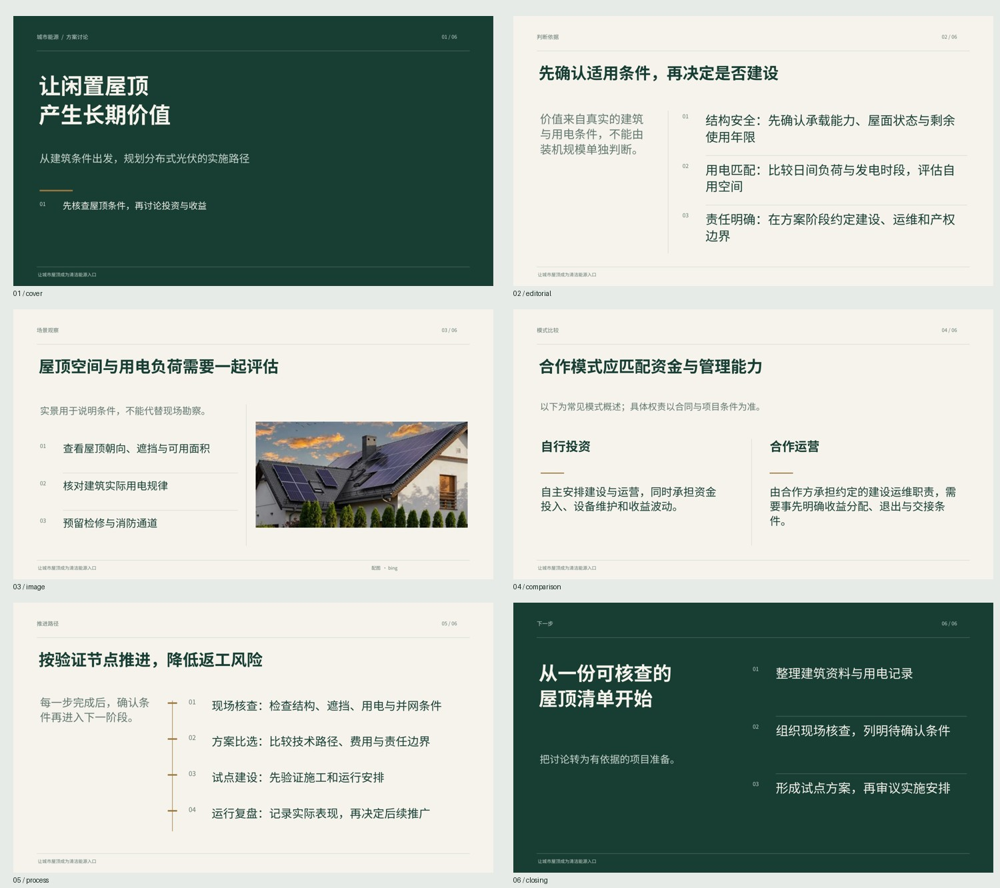

# PPT 生成设计与提示词维护

本轮参考用户提供的 Kimi PPT skill：`/home/figodxp/workspace/skill_research/ppt/skills/kimi-slides`。重点采纳受众任务、场景分类、逐页目标、版式节奏、实质图片、证据边界与渲染校验。

## 生成流程

1. 策划：选择主场景，规划每页标题、读者目标、版式及配图意图。
2. 写作：按场景和逐页计划编写内容，保留事实来源与条件，控制正文密度。用户未要求时不新增讲稿。
3. 结构检查：页数必须匹配；对比需两项、流程需 2–5 步。过密或结构不符时最多调用一次修订 Agent；仍不适配的布局由渲染器完整保留内容并回退，同时提示。
4. 素材：只为确实需要实景/图示的页面检索；`imageIntent=none` 不自动搜索，用户选定的现有图片优先。
5. 排版：输出可编辑的原生文字、分隔线、流程结构与嵌入图片。中文使用 Noto Sans CJK SC；Docker 渲染时挂载本机对应字体，减小字体替换差异。
6. 验证：估算文字框容量、保持图片比例；真实 LibreOffice 转 PDF 后检查页数、文字完整性与页面边界，结果进入生成检查。文本层检查是辅助提示，不能代替人工视觉验收。

## 六类页面

| 版式 | 用途 |
| --- | --- |
| 开场封面 | 主题、价值与关键判断，深色底与大标题 |
| 重点阐述 | 引言与编号证据、细线分隔、不对称布局 |
| 图文展示 | 实景/产品/截图与文字分区，完整保留图片比例 |
| 双项对比 | 两种选项的收益、代价和适用条件 |
| 步骤流程 | 有先后关系的步骤及完成条件，原生连线 |
| 结论与行动 | 核心结论及可执行下一步 |

页面「编辑」中可以改版式、章节标签与内容来源，点击「应用修改并更新预览」生成实际排版。草稿是内容示意，播放/PDF/导出使用实际 PPT 渲染结果。

用户公司模板优先，保留现有母版、品牌素材及布局；上述内置版式用于无模板生成。模板填充仍有原有的复杂多文本框适配限制，此轮不将它宣称为完整自动模板重设计。任意图表、自由坐标设计和动画不在本轮实现范围。

## 提示词目录

所有角色与设计指令位于 `prompts/ppt/`，职责说明见 [提示词库](../prompts/ppt/README.md)。每次任务读取一份快照，同一任务不受编辑文件的中途变化影响，下一次任务即可使用新提示词，无需重启。

常用调整入口：

- `common.md`：写作原则与事实边界。
- `layouts.md`：实际支持的版式和文字预算。
- `planner.md` / `writer.md` / `editor.md` / `repair.md`：各阶段职责。
- `scenarios/`：管理汇报、分析决策、商业提案、技术工程、学术、培训、品牌与通用场景。

`generationMeta.promptVersion` 是本次提示词快照哈希，`scenario` 是主场景，存储在工作记录中；AgentScope 的任务根节点也记录 `ppt.prompt.version` 与 `ppt.scenario`。提示词修改不会自动重做已有文件。

Kimi 专用 CLI 和 PPTD 编辑器不在当前环境；这里移植设计原则到已有 AgentScope + python-pptx + LibreOffice 流程，保持 PPTX/PDF 导出、局域网预览及工作记录编辑兼容。

## 已验证示例

六版式样张（人工整理内容，验证排版）：

- [PPTX 样张](../runtime/test-results/design-layouts/presentation.pptx) / [PDF 样张](../runtime/test-results/design-layouts/presentation.pdf)
- [真实 MiniMax-M3 生成稿](../runtime/test-results/design-live-final/presentation.pdf)：使用本次提示词生成 6 页，随后在编辑区保存版式/来源并移除无关配图，最终重新渲染。
- [浏览器编辑区](studio-design-editor.png)

示例文件独立保存，不加入用户的工作记录。验证过程和限制见 [验收记录](verification.md)。
